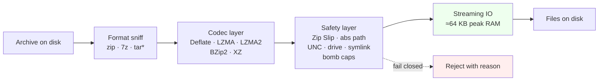

# OpenZipper


A self-contained archive tool that reads and writes zip, 7z, and the tar family without shelling out to 7-Zip, WinRAR, tar, or any other external decompressor. Safe by default — Zip Slip, absolute paths, UNC, drive letters, symlinks, and zip bombs all get rejected before they ever touch disk.

## 🎯 Why OpenZipper

Every desktop app that ships a zip reader ends up bundling 7-Zip DLLs, shelling out to `tar`, or reimplementing the same safety checks over and over. OpenZipper handles all of that in one native module. Every archive is scanned for structural attacks before extraction starts. The streaming pipeline keeps peak memory near 64 KB regardless of archive size. And the same engine powers both the CLI and the native bridge, so your automation scripts and your GUI talk to the same engine.

## ✨ What it does

- **Multi-format read and write** — read zip (Deflate), 7z (LZMA / LZMA2 / PPMd / BZip2 / Deflate), tar, tar.gz, tar.bz2, tar.xz; write zip plus the entire tar family.
- **Fail-closed safety layer** — rejects Zip Slip (`..` traversal), absolute paths (`/`, `C:\`), UNC paths (`\\server\share`), drive letters, symlink escape, and nested archive recursion that would bypass the destination root.
- **Zip bomb detector** — hard caps on entry count, per-entry size, total size, compression ratio, and nested archive depth. Any threshold trips an early abort with a clear reason.
- **Streaming I/O** — zip creation streams directly to disk; extraction pulls bytes off disk and decompresses them on the fly. Peak memory stays around 64 KB and does not grow with archive size.
- **Collision policies** — pick `error`, `skip`, or `rename` for name clashes. Overwrite is never the silent default.

## 📘 CLI cookbook

```bash
# List entries and flag anything the safety layer already rejected
open-zipper list archive.zip --json

# Preview an extraction — nothing is written to disk
open-zipper extract archive.zip --dest ./out --dry-run

# Actually extract, renaming any clash
open-zipper extract archive.zip --dest ./out --overwrite rename

# Verify every entry in an archive round-trips correctly
open-zipper test photos.tar.gz

# Create a zip from a directory
open-zipper create ./photos --out photos.zip --format zip
```

## 🗺️ End-to-end archive pipeline



## 🧰 Library usage

The same engine is exposed through the native bridge for Node projects:

```ts
import { extract, listEntries, createArchive } from '@wae/open-zipper';

const listing = listEntries({ path: 'download.zip' });
if (listing.unsafeEntryCount > 0) throw new Error('unsafe archive');

const report = extract({ path: 'download.zip', destination: './out', overwrite: 'rename' });
console.log(`wrote ${report.written} files, ${report.bytesWritten} bytes`);
```

## ❌ What it does NOT do

- **Does not support RAR** — the UnRAR free license prohibits building an archiver from it, so RAR parsing is intentionally out of scope.
- **Does not read or write encrypted archives** — AES-256 zip, password-protected 7z, and encrypted tar entries return an `encrypted_archive` error instead of attempting decryption.
- **Does not create 7z archives** — 7z is read-only. For writing, pick zip or one of the tar family formats.
- **Does not preserve NTFS ACLs or ADS** — file permissions, ownership, and alternate data streams are not round-tripped today.

## 🖥️ Platform notes

Core read/write and safety checks run identically on Windows, macOS, and Linux. Each release ships a native binary per platform under the corresponding `packages/open-zipper-*` native package. Check `open-zipper capabilities` for the exact codec set on your build.
